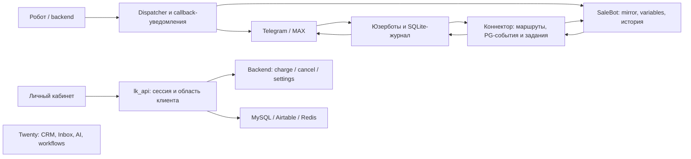

# Research: Twenty как единая CRM общения вместо SaleBot

Статус документа: датированное исследование закреплённых исходников; описания тогдашней среды и «следующих шагов» ниже исторические. Текущие результаты обновления, состояние плана и порядок работы — [STATUS.md](STATUS.md). Нормативные решения по автоматизации — [design/09](design/09-automation-contract.md); runtime этой доработки ещё не написан.

> Последующее решение D-18 / требования v0.5: подписку Twenty не используем, необходимые коммерческие возможности реализуем самостоятельно. Старые вопросы выбора редакции ниже больше не открыты. Коммерческая лицензия допускает development/testing без подписки; это не бесплатная production-лицензия. См. [границы переиспользования](design/07-license-boundary.md).

> Изменение объёма 26.10.2026: действуют [требования v0.4](requirements.md) и решение D-16. Тендерный робот, его API/данные/операции и переключение его отправителей исключены из проекта. Ниже сохранено исследование прежнего объёма v0.3: строки R-07, robot-части R-10/F-05, схема робота и связанные риски/тесты являются историческими фактами, а не задачами или условиями приёмки CRM. Актуальная дорожная карта — [plan/roadmap.md](plan/roadmap.md).

Дата: **26.10.2026**. Фаза: исследование исходников и контрактов завершено; архитектурное решение, технический план и реализация ещё не выполнены. Исследование покрывает подтверждённые требования [v0.3](requirements.md), а не сокращённый вариант только с Telegram или ИИ-черновиками.

Последующее изменение среды: после этого исследования пользователь разрешил обновить демо; установлен стабильный релиз **2.51.0** — [отчёт](../twenty_upgrade_2_51/report.md). Упоминания 2.50.0 ниже фиксируют состояние во время исследования. Checkout и выводы по коду main2.52.0 автоматически не приравниваются к установленному релизу.

Уточнение после сравнения 2.51→2.52: принят [снимок 2.52 и состав переиспользования](reuse-2.52.md). Найден ранее пропущенный APP API `ingestMessages`: он уже поддерживает импорт внешнего текста, дат, участников и связей CRM в 2.51. Исходящие сообщения и вложения этим API не реализованы. Соответствующие выводы ниже исправлены.

## 1. Результат

Готовый код позволяет переиспользовать значительную часть системы: CRM, учётные записи сотрудников, роли, ИИ и workflow Twenty; транспорт, маршруты и очереди наших юзерботов; клиентские API робота. **Готового объединённого решения в этих проектах пока нет.**

Ключевые факты:

1. В исходниках Twenty есть внутренний AI Inbox с участниками, авторством, назначением, непрочитанным и обновлениями экрана. Другая модель, `Message/MessageThread`, используется email pipeline и APP API приёма внешней переписки. Ни один из проверенных путей не является готовым Telegram/MAX-коннектором.
2. При первом исследовании демо использовало **2.50.0**; затем проверенно обновлено до **2.51.0**. Для кода принят снимок **2.52.0**. Серверные совместные AI threads и APP ingestion уже были в 2.51; включение UI/feature flags и работоспособность нашей интеграции требуют отдельной проверки.
3. Коннектор уже имеет Partner API управления адаптерами, долговечные журналы, очередь, дедупликацию и обработку неопределённого результата отправки. Но входящие задания, история, сверка карточек и часть файлов связаны с SaleBot.
4. API робота уже умеет читать реальные данные, заряжать, отменять и менять настройки. Его `manager_uuid` обозначает клиента/лицензию робота, а не сотрудника Twenty. Соответствие этих личностей и прав предстоит спроектировать.
5. Замена SaleBot затрагивает и исходящие уведомления робота. Переключения только экрана или одного webhook недостаточно.
6. Штатные ограничения Twenty на отдельные записи — **Organization / Enterprise**. Общие роли и права полей не заменяют правило «сотрудник видит только своих клиентов/сделки». Это влияет на выбор архитектуры и стоимости; наличие исходников не отменяет отдельную лицензию этих файлов.

Подробные доказательства, пути, символы и границы проверки:

- [Twenty: сообщения, Inbox, SDK и файлы](research-twenty-messaging.md).
- [Twenty: права, ИИ, workflow и лицензирование](research-permissions-ai.md).
- [Telegram/MAX и зависимости коннектора от SaleBot](research-connectors.md).
- [API робота, личность клиента и прикладные действия](research-robot-api.md).

## 2. Источники и достоверность

| Источник | Зафиксированная база | Что действительно проверено |
|---|---|---|
| Наш форк Twenty | upstream `729f6236126eddaa68d176fb766bc349b19de11d`, до исследования HEAD `2ee4d65aa34ba3ae6b0f561ed7051df51cadc0d8` | Исходники, call sites, модели, документация, ограничения SDK, наличие и содержимое релевантных тестов. |
| Демо Twenty | Compose `twenty-demo`, образы server/worker `twentycrm/twenty:v2.50.0`, PG16, Redis7.4 | Read-only SSH: имена, образы и состояние контейнеров. Схема БД, миграции, лицензия и работоспособность ИИ не квалифицировались. |
| Connector/Telegram | основной checkout `e2352f2e`, connector-live `a4505658` | Исследованные runtime-файлы совпадают; найден актуальный Partner API. Состояние конкретных живых аккаунтов не проверялось. |
| MAX | `max-claude-export`, `263b2116b1dbaadbe88ddb362bed48df56a3f78c` | Чистая найденная копия с журналами, native history, голосом и внешними отправками. Старая dirty staging-копия не принята за актуальную базу. |
| Робот / ЛК | `0171137876c2d1297a06a0a1a915d3501f22dc45`, исследованные `lk_api`/`lk_frontend` чистые | Код и изолированные тесты. В остальных частях checkout есть изменения других задач. |
| Backend робота | `rob719-server-reconcile`, `0755947c9c28be49268c2d34bbf7a700744b5e06` | Три исследованных ключевых файла совпадают с сохранённой версией выката `5e59599`. Это не свежая сверка контейнера. |

Точные локальные корни указаны в профильных отчётах. Различены исходники, сохранённые сведения о выкате, текущие образы демо и фактические тесты. Секреты, идентификаторы живых клиентов и их переписки не переносились в документы.

## 3. Матрица требований

Обозначения: **переиспользуем** — соответствующий механизм найден, но ещё не интегрирован; **адаптируем** — готовая часть имеет другой контракт; **добавляем** — нужной связки не найдено; **уточняем** — нужен продуктовый выбор или проверка runtime. Это не готовый implementation plan.

| Требование | Готовая основа | Что остаётся | Статус / доказательство |
|---|---|---|---|
| R-01. Полная замена SaleBot | Независимые send/jobs API и native юзерботы | Убрать зависимости mirror/variables/history/media/reconciliation; переключить уведомления робота; отдельно инвентаризировать используемые функции SaleBot | **Адаптируем + добавляем**; connector §3/7, robot §6 |
| R-02. Максимум Twenty | CRM, пользователи, роли, workflow, AI, внутренний Inbox, SDK | Выбрать подходящую версию и способ расширения без ложного представления клиента как сотрудника/ИИ | **Переиспользуем + уточняем**; Twenty messaging и permissions/AI |
| R-03. Telegram и MAX | Оба адаптера, журналы, доставка, история | Коннектор Twenty и согласованная матрица типов сообщений; live-проверки на тестовых аккаунтах | **Адаптируем**; connector §2–6 |
| R-04. Подключение юзерботов | Partner API регистрации, enable/disable, проверки готовности | Регистрация адаптера не делает login/QR/2FA. Выбрать UI подключения и место исполнения; не объединять эти решения автоматически | **Переиспользуем + уточняем**; connector §4 |
| R-05. Импорт истории | SaleBot history, PG-журнал, native history, составной архив; Twenty APP ingestion с исходной датой, явными identity links и дедупом внутри канала | Адаптер источника, checkpoints, нормализация externalId, файлы, запрет автоответов/бизнес-событий при импорте; не дублировать готовый приём текста | **Адаптируем + добавляем**; connector §5, Twenty messaging, reuse-2.52 |
| R-06. Полноценный ИИ Twenty | Providers/models, agents/skills/tools, runAgent, workflow | Клиентский контекст, база знаний, режим автоответов, человек/ИИ, вызов транспорта и связь с доставкой | **Переиспользуем + добавляем**; permissions/AI |
| R-07. Реальные данные робота | API закупок, статусов, комиссий, итогов, SSE | Проверенное соответствие клиента/фирм, обработка недоступности и актуальности данных | **Адаптируем**; robot §2–5 |
| R-08. Отдельный проект | Форк и документы в папке `Twenty CRM` | Новые модули размещать здесь после Design; среда разработки Linux/WSL ещё не подготовлена | **Выполнено для исходников и документов**; PROJECT.md |
| R-09. Несколько менеджеров | Twenty users/roles; внутренние thread participants, авторство, assignee, sharing/read state | Клиентские участники и маршруты, аудит исходящих, разграничение диалогов, конкурентные ответы/передача человеку | **Переиспользуем + адаптируем + добавляем**; Twenty messaging, connector §4 |
| R-10. Максимум прикладных действий ИИ | CRUD/workflow tools Twenty; charge/cancel/settings робота | Матрица tools и полномочий, delegated client identity, условия выполнения и наблюдение результата | **Переиспользуем + адаптируем**; permissions/AI, robot §3/7 |
| R-11. Видимость сделок и этапов | Объектные/полевые права, RLS, sharing; stage как SELECT | Решение по редакции/реализации; матрица переходов; проверка прав через UI/API/AI/экспорт/связи | **Адаптируем + уточняем**; permissions/AI |

Функциональные разделы F-01…F-08 также покрыты: подключения — connector §4; чат/CRM — Twenty messaging; ИИ/workflow — permissions/AI; робот — robot API; история — connector §5; совместная работа и доступ — оба исследования Twenty. Полнота требований не означает готовность этих функций к эксплуатации.

## 4. Текущие потоки и внешние границы

Схема отражает найденные существующие цепочки, а не целевую архитектуру и не проверку текущего состояния каждого сервиса. Отсутствие соединения Twenty с этими потоками намеренно: готовая интеграция в исследованном коде не найдена.

### Приём и ответ

Юзербот фиксирует источник сообщения, коннектор сохраняет события/задачи с курсором, worker выполняет отправку или публикацию в SaleBot. Уникальный маршрут включает платформу, аккаунт и чат. Ни имя клиента, ни номер карточки одной CRM не заменяют этот ключ.

`POST /v1/routes/{route_id}/send` уже принимает стабильный command_id и возвращает **202 queued**, а не успешную доставку. API платформы может принять сообщение, но факт получения/прочтения клиентом этим не доказан. Unknown после возможного внешнего эффекта нельзя превращать в слепую повторную отправку. Эти гарантии надо сохранить при добавлении Twenty.

Совместная работа нескольких менеджеров возможна над одним личным чатом. Для этого не нужны внешние групповые чаты. Нативные группы Telegram/MAX текущие адаптеры намеренно отфильтровывают; если они понадобятся, это отдельное расширение.

### ИИ и операции робота

В Twenty уже есть путь caller → роль агента/приложения → tools → executor. В роботе есть другая цепочка token ЛК → клиентский uuid → разрешённые фирмы → прикладной API. Между ними отсутствует проверенная серверная связь. Её нельзя заменить совпадением имени, prompt-инструкцией или firm_id из текста клиента.

Максимальные возможности ИИ включают реальные прикладные операции. Для каждой операции потребуется различать принято, выполняется, выполнено, отклонено, результат неизвестен. В частности, timeout charge не доказывает, что зарядка не состоялась; повтор может создать второй эффект. Управление контейнерами, произвольный SQL и чтение учётных данных не являются найденными клиентскими API.

### Импорт

Архив коннектора — составной файл с двумя источниками, а не готовый набор исторических сообщений Twenty. PG retention по умолчанию 30 дней; фактическое значение не читалось. Native history имеет ограниченные окна/страницы, которые надо обходить с checkpoints. Старые файлы и полная история могут быть недоступны.

Импорт должен сохранять первоначальные время, автора, маршрут и внешние ID, учитывать повторное выполнение и явно сообщать неполноту. Обычный native backfill может попасть в рабочую очередь как новое сообщение; режим миграции обязан исключить клиентские автоответы и запуск бизнес-процессов на старой истории.

## 5. Ограничения, влияющие на выбор архитектуры

| Ограничение | Практическое следствие |
|---|---|
| Демо обновлено до 2.51; база кода — фиксированный снимок 2.52 | Состав исходников проверен; сборка и пробный переход на копии данных ещё нужны. Наличие кода не означает его выкат. |
| APP ingestion уже принимает текст/даты/участников, но не отправляет наружу и задаёт attachments:[] | Переиспользовать существующий импорт и связи CRM; отдельно реализовать доставку, вложения и связь с рабочим местом оператора. |
| Внутренний Inbox адресует workspace members; app sendInboxMessage использует ASSISTANT | Для входящих клиентов нужен честный внешний actor/route contract. Нельзя подменять импорт вызовом внутреннего уведомления. |
| `shouldAssistantReply:false` зависит от флага Inbox | Настройки и feature flags влияют на включение модели; импорт/сообщение оператора требуют отдельного негативного теста. |
| SDK query/mutation есть, штатной subscription в runtime-клиенте нет; fetch bridge буферизует ответ | Собственный экран через SDK возможен, но realtime/SSE и сценарии чата требуют проверки. Это не доказательство невозможности SDK и не основание сразу переписывать ядро. |
| Signed file URL проверяет capability, а не заново всю роль сотрудника | Выдача URL, срок, отзыв доступа и вложения связанных скрытых записей — самостоятельная часть модели прав. |
| RLS и validation rules имеют Enterprise-лицензию | Нельзя закладывать их как бесплатно доступную production-функцию. Нужен отдельный выбор редакции/реализации. |
| Custom AI providers в данной версии ограничены 25 seats без Organization | Важно при выборе собственного gateway/локальных моделей; встроенные провайдеры self-hosted доступны и на Free. |
| ЛК допускает stale-профиль при некоторых сбоях; финансы местами считаются на уровне фирмы | Для сотрудников/автономного ИИ надо явно определить отзыв прав и финансовую видимость, не обещать уже существующую полную изоляцию. |
| Вне коннектора есть прямые отправки робота/MAX | Cutover должен учитывать все отправители и выбрать одного владельца исходящего сообщения. |

Лицензионные факты сверены с кодом и первичными источниками: [permissions](https://docs.twenty.com/user-guide/permissions-access/capabilities/permissions), [AI FAQ](https://docs.twenty.com/user-guide/ai/how-tos/ai-faq), [LICENSE](https://github.com/twentyhq/twenty/blob/729f6236126eddaa68d176fb766bc349b19de11d/LICENSE). Это состояние на дату исследования, а не обещание неизменных тарифов. Покупка лицензии или обход ограничений не выполнялись.

## 6. Что достаточно известно для Design

Теперь можно сравнить три способа реализации на реальных ограничениях:

| Вариант для сравнения | Основание в коде | Что сравнить/проверить |
|---|---|---|
| SDK-приложение и существующие внешние транспорты | Custom objects, front components, logic functions, agents/skills и API | Realtime, удобство общего Inbox, права и контекст tools, стоимость собственного экрана/модели сообщений. |
| Расширение штатного Inbox и серверных модулей форка | Уже есть совместные участники, авторство, assignee, SSE, связи CRM | Внешние actors/routes/statuses/import, зависимость от новой версии, объём изменений ядра и сопровождение обновлений. |
| Комбинация SDK и небольших расширений ядра | Доступны обе точки расширения | Какие конкретно ограничения SDK требуют изменения ядра; не дублируются ли история, права, очереди и UI. |

Таблица — набор вариантов следующей фазы, **не утверждение, что все они уже прошли квалификацию**, и не финальный выбор. В каждом случае отдельно сравниваются управление подключением в Twenty и размещение процесса юзербота. Экран QR внутри CRM сам по себе не требует переносить Telethon/MAX-сессию внутрь NestJS.

Design должен определить:

1. Версию Twenty и подход к коммерческим функциям доступа.
2. Владельца диалога/истории и идентичность: контакт, фирма, внешний участник, маршрут, сотрудник, ИИ.
3. Формат входящих/исходящих событий и команд, дедупликацию, порядок, доставку, файлы, повторное подключение.
4. Совместную работу и полномочия: читать, отвечать, назначать, передавать, видеть сделку, менять этап/воронку, выполнять каждый tool робота.
5. Арбитраж менеджера и ИИ: кто отвечает сейчас, как остановить/отменить устаревший ответ, как хранить реального автора и результат действия.
6. Импорт, подавление автоматизаций, переход с SaleBot и откат без двух отправителей.
7. UI списка чатов, диалога и клиентской карточки в согласованном стиле личного кабинета, включая ошибки/ожидания/права.

Открытые продуктовые вопросы сохранены в [open-questions.md](open-questions.md). Для этой исследовательской фазы не требовалось выдумывать ответы: масштаб, точные роли, источник истории, native-группы и используемые функции SaleBot должны уточняться там, где действительно влияют на решение.

## 7. Проверка и оставшаяся работа

Выполнено:

- Чтение моделей, реализаций, вызовов, конфигурационных контрактов и тестов четырёх направлений; зафиксированы ревизии и отличия checkout.
- Read-only проверка образов и health контейнеров демо Twenty.
- Изолированные тесты робота/ЛК: **106 passed**.
- Изолированные backend-тесты: **29 passed, 1 skipped**. Модуль settings пропущен из-за отсутствия `pymysql`; это не успешная проверка settings endpoint.
- Проверка документов, ссылок и состава diff перед отдельным commit/push этой задачи.

Не выполнено и не объявляется готовым: сборка/запуск нашего снимка 2.52 и квалификация перехода на него с 2.51, интеграционные тесты коннектора с PG18, live Telegram/MAX-доставка, импорт клиентской истории, настройка ИИ, сквозная авторизация, изменение робота/коннектора, переключение клиентов или отключение SaleBot. Отдельный переход официального демо 2.50→2.51 выполнен и описан в отчёте обновления.

Следующий результат — документы **Design**: сравнение вариантов и выбранные границы модулей, схемы данных/потоков, матрица прав и ИИ-инструментов. Затем технический план с этапами, проверками и откатом. Исследование не заменяет эти шаги.
