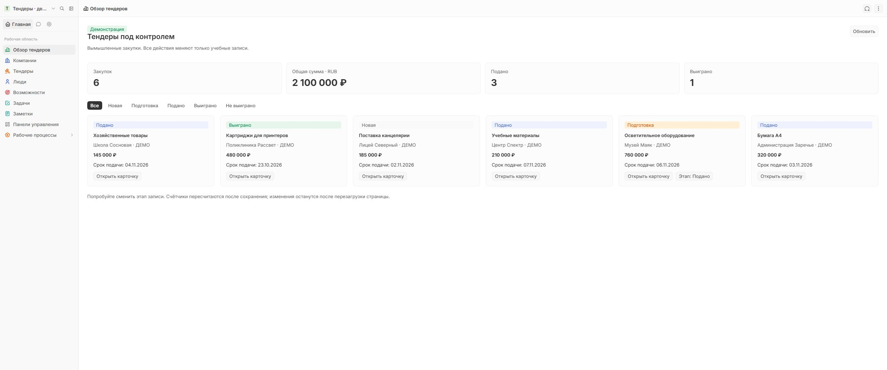

# Результат обновления Twenty

26.10.2026: экземпляр `twenty-demo` успешно обновлён **2.50.0 → 2.51.0**. Это последний опубликованный стабильный релиз, проверенный через GitHub Releases API на момент операции. Версия 2.52.0 в checkout main не устанавливалась.

- [Релиз 2.51.0](https://github.com/twentyhq/twenty/releases/tag/twenty/v2.51.0).
- [План, границы и откат](plan.md).
- Выполненный полный скрипт из Git: commit `2860b94a`, `upgrade.py`, SHA256 `e4626942594580c7aad26d49a4dc18e6c47050dce23f66fd6de0c27187c686ff`.
- Образ server и worker: `twentycrm/twenty:v2.51.0`, digest `sha256:91793759486e63768b28cc7bebe6c06d73f5a604cdb8cc7d7b54f862542714be`.
- Доступ: [Twenty](http://localhost:2020/).

## Проверки

| Проверка | Результат |
|---|---|
| `upgrade:status` | APP_VERSION v2.51.0; instance up to date; 1 workspace up to date, 0 behind, 0 failed |
| Rich text → TipTap | Документированная команда завершилась успешно; дополнительный вызов после автоматического upgrade конвертировал 0 записей/версий/widget, ошибок нет |
| Server | healthy, restartCount 0 |
| Worker | running на том же образе 2.51.0, restartCount 0 |
| Последние 120 строк server/worker после обновления | ERROR/FATAL не найдено; это проверка этого окна логов, не гарантия отсутствия будущих ошибок |
| HTTP и локальный SSH-туннель | `/healthz` — 200 |
| Основные CRM-данные | Количество и множество ID до/после совпадают: компании 8, люди 5, сделки 6, заметки 0, задачи 0 |
| Рабочие процессы в браузере | Quick Lead и Create company when adding a new person отображаются с активными версиями; тестовый запуск не выполнялся |
| Заметки в браузере | Страница загружается; 0 заметок было и до обновления. Проверку редактирования непустой заметки это не заменяет |
| Наше SDK-приложение | Обзор тендеров загрузился: 6 закупок, 2 100 000 RUB, подано 3, выиграно 1; карточки отображаются |
| Прочие сервисы | Множество ID работающих контейнеров вне проекта twenty-demo совпало до/после; DB/Redis Twenty не пересоздавались |

## Резервная копия

На сервере: `/opt/twenty-demo/backups/before-2.51.0-20261026T063415Z` (каталог 0700).

- `twenty.dump` — 1 372 678 байт, custom-format dump; `pg_restore --list` успешно прочитан. Полное тестовое восстановление в отдельную БД не выполнялось.
- `local-storage.tar.gz` — 28 706 909 байт; список архива успешно прочитан.
- `redis.rdb` — 3 549 222 байта, снят после остановки server/worker.
- Полные прежние `.env` и `docker-compose.yml`, hashes, счётчики/ID-digests, inventory и журналы обновления.

Содержимое backup, секреты и клиентские данные не включены в репозиторий. Старый образ оставлен. Возврат требует согласованного восстановления данных и версии, а не одной замены TAG.

## Граница результата

Это обновление демо, не реализация клиентских Telegram/MAX-чатов и не перенос SaleBot. Checkout форка с исследованиями остался на прежней базе исходников 2.52.0; отдельный tag 2.51.0 загружен для проверки релизного кода. Коммерческие функции, провайдер ИИ и дополнительные feature flags в рамках обновления не включались.

